# Дипломный проект: автоматизация развёртывания приложения и инфраструктуры

Цель проекта — построить воспроизводимый процесс развёртывания приложения в Kubernetes с использованием инструментов Infrastructure as Code, автоматизации конфигурации, контейнеризации и мониторинга.

В рамках проекта планируется реализовать:
- Terraform — описание и управление инфраструктурой как кодом;
- Docker — сборку и запуск контейнеризированного приложения;
- Ansible — автоматизацию настройки серверов и подготовки узлов к работе;
- Kubernetes — оркестрацию контейнеров и управление приложением;
- Flannel — сетевое взаимодействие между Pod кластера;
- CI/CD — автоматизацию сборки и развёртывания приложения;
- Prometheus и Grafana — сбор метрик и визуализацию состояния системы.

На текущем этапе выполнена первоначальная настройка инфраструктуры в Yandex Cloud с использованием Terraform. Развёрнут трёхузловой Kubernetes-кластер, настроен сетевой плагин Flannel и проверено взаимодействие между Pod на разных узлах.

Подробное описание выполненных этапов и подтверждающие скриншоты приведены ниже.

Дальнейшие этапы проекта включают автоматизацию настройки узлов, развёртывание приложения, настройку CI/CD и мониторинга.

## История выполнения проекта

Первоначальная инфраструктура развёртывалась в Yandex Cloud. Описание этого этапа сохранено в репозитории как история выполненной работы, включая конфигурации Terraform и результаты проверок.

## Приостановка облачного этапа и дальнейший план

В процессе выполнения проекта возник инцидент на стороне Yandex Cloud, затронувший доступность вычислительных ресурсов в используемых зонах доступности.

На момент фиксации текущего состояния виртуальная машина devops-k8s-worker-b отображается в статусе RUNNING, однако операция её перезапуска длительное время остаётся незавершённой. При попытке остановить машину консоль возвращает ошибку Service is overloaded. Управляющая виртуальная машина devops-diploma-vm остановлена, чтобы сократить расходы на вычислительные ресурсы.

В связи с этим дальнейшая работа над проектом в исходной облачной инфраструктуре временно приостановлена.

Для продолжения проекта была рассмотрена возможность использования локальной среды VirtualBox. На компьютере имеются три виртуальные машины, которые потенциально можно использовать для развёртывания локального стенда.

## Выполнение работы в среде YC

Terraform и провайдер работают, validate проходит

Создана инфраструктурная сеть для проекта: 
- использована существующая VPC-сеть Yandex Cloud netology-network, 
- в зоне ru-central1-a создана подсеть devops-diploma-subnet-a с адресным диапазоном 10.10.0.0/24. 

Управление подсетью выполняется через Terraform. Состояние инфраструктуры синхронизировано, terraform plan подтверждает отсутствие изменений.

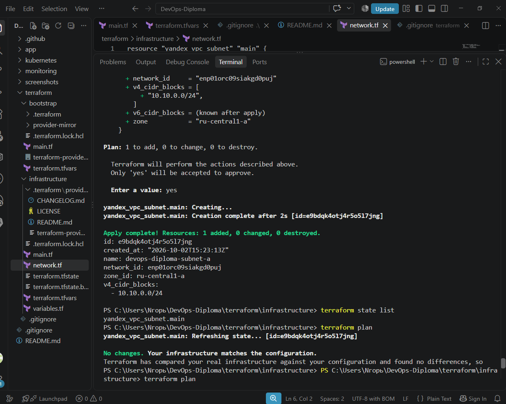

VM успешно создана

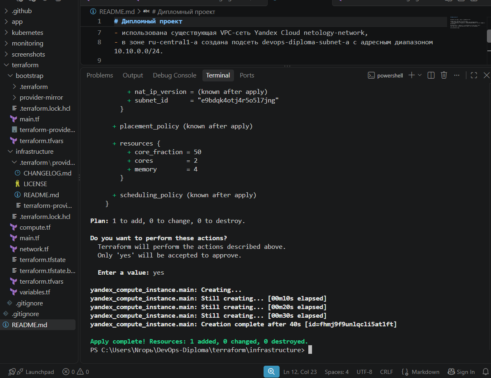

проверила, что Terraform управляет обоими ресурсами, а так же, проверила что после создания VM Terraform не видит никаких расхождений между .tf-конфигурацией и реально созданными ресурсами.

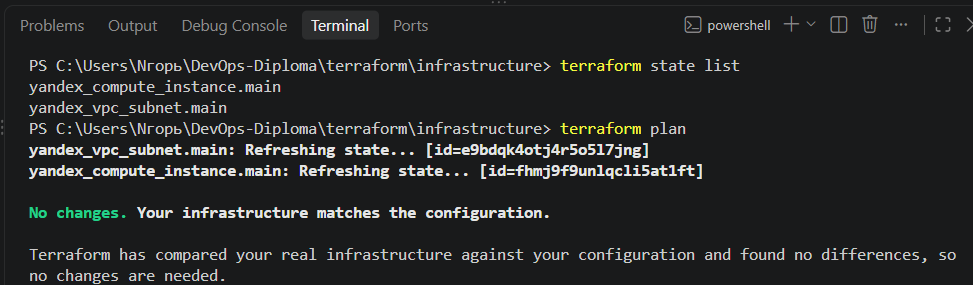

подняла докер

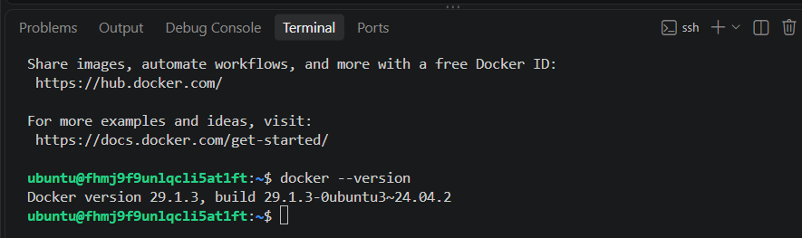

Docker успешно установлен и запущен на VM.

Проверена работа Docker без sudo от пользователя ubuntu:
- пользователь добавлен в группу docker;
- выполнена команда `docker ps`;
- успешно запущен тестовый контейнер `hello-world`;
- версия Docker: 29.1.3.

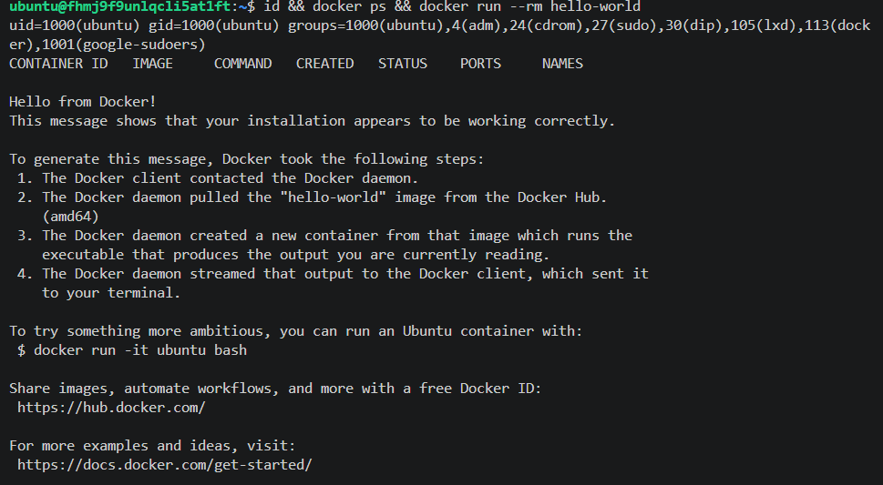

Далее, Terraform и Yandex Cloud полностью синхронизировала:
- VM A — devops-diploma-vm
- VM B — devops-k8s-worker-b
- VM D — devops-k8s-worker-d
- 3 зоны: ru-central1-a, ru-central1-b, ru-central1-d
- Worker B и D — preemptible
- Worker D — security group зафиксирована в Terraform
- SSH к D работает
- Terraform не видит drift
- terraform plan не предлагает изменений

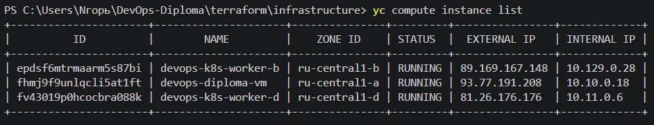

Итоговая проверка инфраструктуры Yandex Cloud: три виртуальные машины в разных зонах доступности, Terraform без расхождений с фактическим состоянием инфраструктуры.

проверила Kubernetes-required sysctl

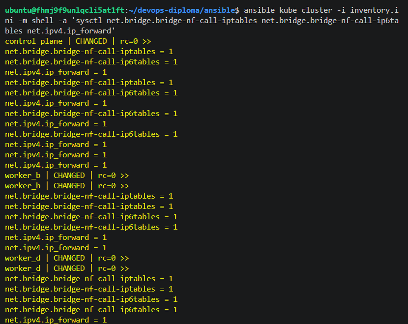

подтвердила, что:
- сеть B-A работает
- Kubernetes API 6443 доступен
- TLS и discovery работают
- kubelet запустился
- сертификат worker получен
- VM B присоединилась к кластеру.
- 
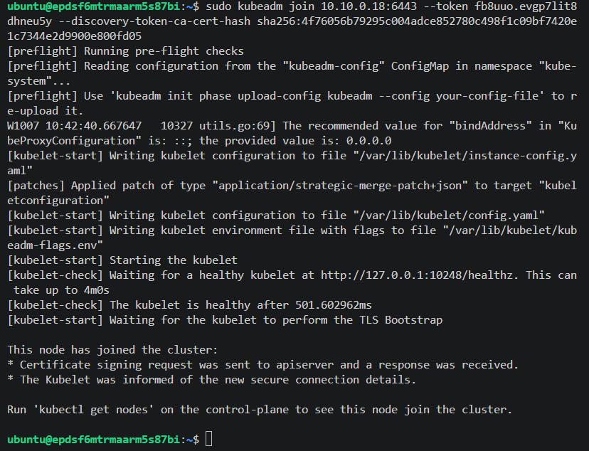

проверила на ВM A — control plane и готовность worker работать в кластере

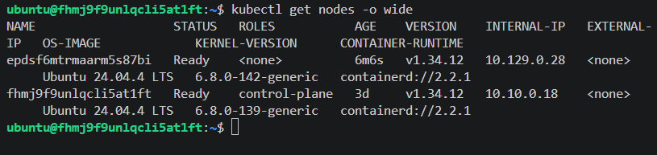

настроила так е ВМ D, и проверила что кластер полностью собран. Развернутый Kubernetes-кластер из трёх VM в трёх availability zones работает.

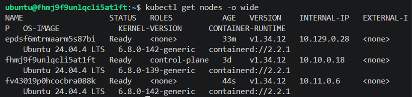

проверила доступ control-plane - kubelet, дальше настроила Flannel, убедилась что он работает на всех трёх узлах

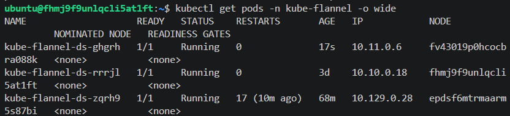

создала временный тестовый под net-test и выполнила тест. 
убедилась, что работает двустороннюю работу Pod-сети ВМ D-ВM A через Flannel VXLAN.

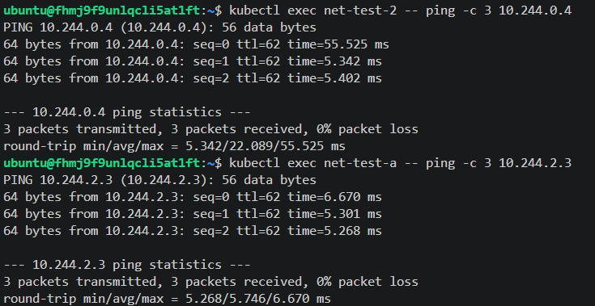

Pod-сеть Kubernetes работает между всеми тремя узлами

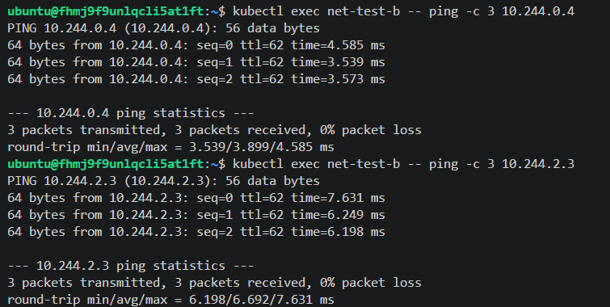

## Локальная инфраструктура VirtualBox

Подготовка ВМ, ОС, ресурсы, сеть, SSH, схема адресации.

## Terraform и Ansible
Способ управления локальными ресурсами, инвентарь, автоматизация настройки узлов.

## Подготовка и проверка Kubernetes
Control plane, worker-узлы, CNI, готовность узлов и сетевые тесты.

## Контейнеризация и приложение
Dockerfile, сборка образа, публикация и Kubernetes-манифесты.

## CI/CD
Автоматизация сборки и доставки изменений.

## Мониторинг
Prometheus, Grafana, сбор метрик и проверка работоспособности.

## Итоговые проверки и выводы
Сценарии проверки, результаты, ограничения и инструкция по воспроизведению.